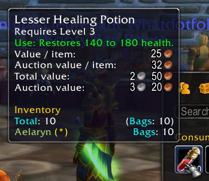

# Valuator

WoW addon that adds vendor sell value and (with aux-addon) auction value to item tooltips — in bags, bank, loot, trade, mail, merchant, auction house, tradeskill, and quest reward windows.

Unlike the addons it sources its data from, Valuator shows all of these values in one consistent, right-aligned coin-icon format, with separate per-item and total lines for stacked items.

## Requirements

- ShaguTweaks (required — provides the vendor price database and item link parsing)
- aux-addon (optional — adds the auction value lines)

## Notes

Valuator disables ShaguTweaks' and Aux's own equivalent tooltip lines to avoid duplicates, replacing them with its unified display.
